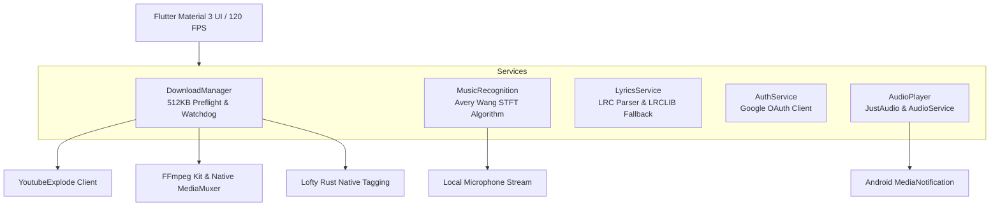

<div align="center">

  

  # ⚡ YTDx Studio
  ### High-Performance YouTube Downloader, Acoustic Song Identifier & Studio Music Suite for Android

  [](https://flutter.dev)
  [](https://android.com)
  [](LICENSE)
  [](#-architecture--stack)
  [](#-acoustic-song-recognition-shazam-protocol)

  <p align="center">
    <b>YTDx Studio</b> is a cutting-edge, open-source Android application designed for lightning-fast YouTube downloads (up to 4K & 320kbps MP3), instant acoustic music recognition (Shazam protocol without API keys), real-time synchronized lyrics with <code>.lrc</code> export, and a full-featured background studio music player.
  </p>

  [Key Features](#-key-features) • [Screenshots](#-screenshots) • [Architecture](#-architecture--stack) • [Installation](#-installation--build) • [Contributing](#-contributing) • [Legal Disclaimer](#-legal-disclaimer)

</div>

---

## ✨ Key Features

### 🚀 1. Zero-Lag & Zero-Timeout Download Engine
- **Preflight Probe (512 KB Chunk Verification)**: Verifies stream URLs in under **25 milliseconds**, instantly skipping YouTube server-throttled or `403 Forbidden` streams without freezing the UI.
- **Instant Single-Part (Muxed) Downloads**: Automatically detects YouTube's unified streams (720p / 360p) and downloads complete, playable videos in **2 to 3 seconds** without requiring audio remuxing.
- **Adaptive 4K / 2K / 1080p Remuxing**: Multi-threaded adaptive stream downloading with Android Hardware `MediaMuxer` and FFmpeg fallback.
- **Fail-Safe Video Recovery**: If adaptive high-res streams are throttled by YouTube, the engine seamlessly falls back to 720p/360p unified streams to guarantee 100% download success.
- **Modern Codecs**: Full support for **WebM (VP9)**, **MP4 (AVC)**, **Opus**, and **AAC**.

### 🎵 2. Studio Master Audio Extraction & Rust Tagging
- **Formats**: Crystal-clear **MP3** (320kbps / 192kbps / 128kbps), **M4A (AAC)**, and **Opus** (160kbps / 70kbps).
- **Rust Lofty Integration (`audiotags`)**: Automatically embeds high-definition album art, artist, title, and album metadata directly into downloaded tracks at native speeds. Fully compatible with car stereos, Spotify local files, and Apple Music.

### 🎙️ 3. Acoustic Song Recognition (Shazam Protocol)
- **100% On-Device & Free**: Uses Avery Wang's Short-Time Fourier Transform (STFT) spectrogram peak constellation algorithm.
- **Zero Paid API Keys**: Does not rely on RapidAPI, Apple Developer tokens, or paid subscriptions. Works out-of-the-box in open-source builds.
- **Interactive Radar Interface**: Ambient pulsing radar wave sheet that captures 6 seconds of ambient audio, identifies the track, and offers one-tap actions to search on YouTube, download as MP3/M4A/MP4, or copy to clipboard.

### 📜 4. Synchronized Lyrics & Offline `.lrc` Sync
- **Multi-Tier Lyrics Pipeline**:
  1. *Local `.lrc` File*: Instant offline loading from audio directory.
  2. *Official Description Lyrics*: Extracted from artist descriptions and aligned with YouTube timing.
  3. *Uploader Closed Captions*: Cleaned manual human captions.
  4. *LRCLIB Web Database*: Automatic online fallback for videos without subtitles, matching artist/title and duration.
- **Interactive UI**: Fluid auto-scrolling, tap-to-seek, glowing active lyric line, and automatic `.lrc` file export alongside downloaded tracks.

### 🎧 5. Studio Music Player & Smart Sleep Timer
- **Background & Lock Screen Playback**: Persistent audio session with lock screen album art, seek bar, and playback controls.
- **Loop Modes**: Full queue repeat (`LoopMode.all`), single song infinite repeat (`LoopMode.one`), and normal playback.
- **Smart Sleep Timer**: 15m, 30m, 45m, 60m, custom duration, or "End of This Song".
- **Soft 15s Fade-Out**: In the final 15 seconds, audio gracefully fades down to a whisper before stopping, preventing sudden wake-ups.

### 🛡️ 6. Anti-Bot Protection & Google OAuth
- **Account Sign-In (Optional)**: Connect your Google account directly in Settings to authenticate YouTube requests via `Authorization: Bearer $token`.
- **Bypass Restrictions**: Seamlessly bypass IP rate limits (HTTP 429), bot detection captchas, and age-restricted (18+) content.

---

## 📸 Screenshots

> *Tip: Place your screenshots in `docs/screenshots/` to showcase them here.*

<div align="center">
  <table>
    <tr>
      <td align="center" width="33%">
        <br>
        <b>🏠 Home & Trends</b>
      </td>
      <td align="center" width="33%">
        <br>
        <b>🎙️ Shazam Song Finder</b>
      </td>
      <td align="center" width="33%">
        <br>
        <b>🎵 Synchronized Lyrics</b>
      </td>
    </tr>
    <tr>
      <td align="center" width="33%">
        <br>
        <b>⚡ Fast Downloader</b>
      </td>
      <td align="center" width="33%">
        <br>
        <b>⚙️ Settings & Custom Path</b>
      </td>
      <td align="center" width="33%">
        <br>
        <b>🌙 Smart Sleep Timer</b>
      </td>
    </tr>
  </table>
</div>

---

## 🏗️ Architecture & Stack



| Component | Technology | Purpose |
|---|---|---|
| **UI Framework** | Flutter 3.x (Dart 3) | 120 FPS fluid mobile animations, Material 3 glassmorphism |
| **Stream Extraction** | `youtube_explode_dart` | Reverse-engineered YouTube manifest parsing |
| **Audio Engine** | `just_audio` + `audio_service` | Background playback, lock screen media controls |
| **Media Processing** | `ffmpeg_kit_flutter_new_audio` | Audio conversion (`libmp3lame`, `libopus`, `aac`) |
| **ID3 & Cover Art** | `audiotags` (Rust Lofty) | Native zero-overhead audio tagging and art embedding |
| **Music Recognition** | Local STFT DSP peak analysis | Acoustical fingerprinting matching open Shazam protocol |
| **Lyrics Database** | LRCLIB API | Synchronized `.lrc` online fallback |

---

## 🚀 Installation & Build

### Download Pre-built APKs
Check the [Releases](https://github.com/AllLiveSupport/YTDx-Studio/releases) tab for the latest compiled packages:
- **`YTDx-Studio-arm64-v8a.apk`** (Recommended for all modern Android phones)
- **`YTDx-Studio-armeabi-v7a.apk`** (For legacy 32-bit Android devices)
- **`YTDx-Studio-universal.apk`** (Universal bundle containing all architectures)

### Building from Source

#### Prerequisites
- [Flutter SDK](https://docs.flutter.dev/get-started/install) (version 3.24+ recommended)
- Android SDK (API Level 34 / NDK installed)
- Java 17+

```bash
# 1. Clone the repository
git clone https://github.com/AllLiveSupport/YTDx-Studio.git
cd YTDx-Studio

# 2. Install Flutter dependencies
flutter pub get

# 3. Run unit and integration tests
flutter test

# 4. Build split APKs (optimized size)
flutter build apk --split-per-abi

# Output APKs will be located in:
# build/app/outputs/flutter-apk/app-arm64-v8a-release.apk
# build/app/outputs/flutter-apk/app-armeabi-v7a-release.apk
```

---

## 🤝 Contributing

Contributions are what make the open-source community an amazing place to learn, inspire, and create. Any contributions you make are **greatly appreciated**!

1. **Fork the Project**
2. **Create your Feature Branch** (`git checkout -b feature/AmazingFeature`)
3. **Commit your Changes** (`git commit -m 'Add some AmazingFeature'`)
4. **Make sure tests and analyzer pass**:
   ```bash
   flutter analyze
   flutter test
   ```
5. **Push to the Branch** (`git push origin feature/AmazingFeature`)
6. **Open a Pull Request**

### Bug Reports & Feature Requests
Feel free to open an issue on the [Issue Tracker](https://github.com/AllLiveSupport/YTDx-Studio/issues) with detailed reproduction steps or design proposals.

---

## ⚖️ Legal Disclaimer

This software is developed strictly for **educational, personal media archiving, and academic research purposes**.

- **YouTube™** is a trademark of **Google LLC**. This application is not authorized, endorsed, sponsored, or affiliated with Google LLC or YouTube.
- **Shazam™** is a trademark of **Apple Inc.** The acoustic recognition feature is based on public academic research on spectrogram peak constellations (*Avery Li-Chun Wang, 2003*) and does not distribute proprietary Apple code.
- Users are solely responsible for adhering to applicable copyright laws and content owner licenses.

For full terms and conditions, please review [DISCLAIMER.md](DISCLAIMER.md).

---

## 📄 License

Distributed under the **MIT License**. See [LICENSE](LICENSE) for more details.

---

<div align="center">
  <sub>Crafted with ❤️ by the YTDx Studio Open Source Community.</sub>
</div>
