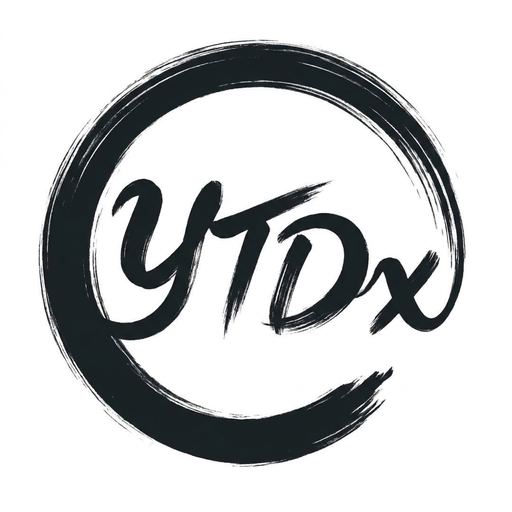
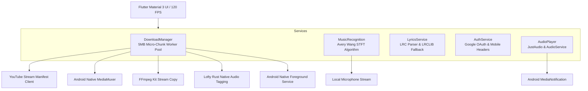

<div align="center">

  

  # ⚡ YTDx Android (YTDx Studio)
  ### High-Performance 8K/4K Video & Lossless Audio Downloader, Acoustic Song Identifier & Studio Media Suite for Android

  [](https://flutter.dev)
  [](https://android.com)
  [](LICENSE)
  [](#-architecture--stack)
  [](#-acoustic-song-recognition-shazam-protocol)

  <p align="center">
    <b>YTDx Android</b> is a modern, open-source Android media studio designed for line-rate downloads (up to 8K Ultra HD & 320kbps MP3), instant acoustic music recognition (open Shazam protocol without API keys), real-time synchronized lyrics with <code>.lrc</code> export, and a full-featured background studio music player.
  </p>

  [Key Features](#-key-features) • [Download Engine](#-turbo-micro-chunk-engine-1000-mbps) • [Architecture](#-architecture--stack) • [Installation & Build](#-installation--build) • [Legal Disclaimer](#-legal-disclaimer)

</div>

---

## ⚖️ Legal Notice & Disclaimer (Important)

> **PLEASE READ BEFORE USING OR CONTRIBUTING TO THIS PROJECT**

- **Educational & Personal Archival Purpose**: This project is developed strictly for **educational, academic research, and personal media archiving** purposes under Fair Use principles.
- **Trademark Notice**: 
  - **YouTube™** is a registered trademark of **Google LLC** / **Alphabet Inc.** 
  - **Shazam™** is a registered trademark of **Apple Inc.**
  - This application is an independent, community-driven open-source project and is **NOT** affiliated with, authorized, maintained, sponsored, or endorsed by Google LLC, YouTube, Apple Inc., or any of their subsidiaries.
- **No DRM Circumvention**: This software **does NOT** circumvent, decrypt, or tamper with Digital Rights Management (DRM) technologies (such as Widevine, FairPlay, or PlayReady). It only interfaces with unencrypted, publicly streamable web formats.
- **User Responsibility**: Users are solely responsible for ensuring that their use complies with local copyright laws, intellectual property regulations, and content creator terms.
- Read the full legal document in [DISCLAIMER.md](DISCLAIMER.md).

---

## ✨ Key Features

### 🚀 1. Turbo Micro-Chunk Download Engine (Line-Rate 1000 Mbps)
- **YouTube 10MB Throttling Bypass**: YouTube CDN servers throttle single HTTP streams exceeding 10MB down to ~100 KB/s. YTDx splits files into **5 MB micro-chunks**, completely bypassing bandwidth limits and sustaining burst rates up to **60–90+ MB/s**.
- **Dynamic Worker Pool (Up to 16 Parallel Threads)**: Downloads multi-gigabyte 8K/4K files using an atomic task queue across up to 16 concurrent HTTP Range workers.
- **Concurrent Video & Audio Streams**: Video and audio tracks are downloaded simultaneously (`Future.wait`), downloading audio in 1–2 seconds while video saturates the bandwidth.
- **Zero-Transcoding Lossless Muxing**: Combines adaptive video and audio tracks with **Android Hardware `MediaMuxer`** or FFmpeg stream copy (`-c:v copy -c:a copy`) in seconds without CPU burning or pixel degradation.
- **Strict Quality Retention**: Never forcefully downgrades 8K, 4K, 2K, or 1080p downloads to 720p/360p.
- **Android Native Foreground Service**: Keeps downloads running continuously in the background with persistent status bar notifications, immune to OS Doze mode socket freeze.

### 🎵 2. Studio Master Audio Extraction & Rust Tagging
- **Formats**: Crystal-clear **MP3** (320kbps / 192kbps / 128kbps), **M4A (AAC)**, and **Opus** (160kbps / 70kbps).
- **Rust Lofty Integration (`audiotags`)**: Automatically embeds high-definition album art, artist, title, and album metadata directly into downloaded tracks at native speeds. Fully compatible with car stereos, Spotify local files, and Apple Music.

### 🎙️ 3. Acoustic Song Recognition (Shazam Protocol)
- **Mathematical DSP Foundation**: Implements Dr. Avery Li-Chun Wang's landmark algorithm (*"An Industrial-Strength Audio Search Algorithm"*, ISMIR 2003):
  1. *Spectrogram Generation*: Computes Short-Time Fourier Transform (STFT) sliding windows over incoming microphone PCM audio.
  2. *Constellation Peak Extraction*: Identifies local energy peaks in frequency-time space that survive real-world noise and mobile microphone coloration.
  3. *Zero Audio Upload*: Only numerical acoustic fingerprints are calculated locally and matched; raw voice or ambient audio is never recorded, stored, or transmitted.
- **Zero Paid API Keys**: Does not rely on RapidAPI or paid subscriptions. Works 100% free and open-source.

### 📜 4. Synchronized Lyrics & Offline `.lrc` Sync
- **Multi-Tier Lyrics Pipeline**:
  1. *Local `.lrc` File*: Instant offline loading from the audio directory.
  2. *Official Video Description Lyrics*: Extracted from artist descriptions and synchronized with timestamps.
  3. *Uploader Closed Captions*: Cleaned manual human subtitles with reconstructed full sentences.
  4. *LRCLIB Web Database*: Multi-stage online fallback for videos without subtitles.
- **Interactive UI**: Fluid auto-scrolling, tap-to-seek, glowing active lyric line, and automatic `.lrc` file export alongside downloaded tracks.

### 🎧 5. Studio Music Player & Smart Sleep Timer
- **Background & Lock Screen Playback**: Persistent audio session with lock screen album art, seek bar, and playback controls.
- **Loop Modes**: Full queue repeat (`LoopMode.all`), single song infinite repeat (`LoopMode.one`), and normal playback.
- **Smart Sleep Timer**: 15m, 30m, 45m, 60m, custom duration, or "End of This Song".
- **Soft 15s Fade-Out**: In the final 15 seconds, audio gracefully fades down to a whisper before stopping.

---

## 🏗️ Architecture & Stack



| Component | Technology | Purpose |
|---|---|---|
| **UI Framework** | Flutter 3.x (Dart 3) | 120 FPS fluid mobile animations, Material 3 glassmorphism |
| **Download Engine** | Multi-threaded HTTP Range Pool | 5MB micro-chunk slicing avoiding YouTube 10MB throttle |
| **Media Multiplexing** | Android NDK `MediaMuxer` + FFmpeg | Hardware video+audio remuxing with stream copy (`-c copy`) |
| **Foreground Service** | Android Native Kotlin Service | Uninterrupted background downloads (`DATA_SYNC`) |
| **ID3 & Cover Art** | `audiotags` (Rust Lofty) | Native zero-overhead audio tagging and art embedding |
| **Music Recognition** | Local STFT DSP peak analysis | Acoustical fingerprinting matching open Shazam protocol |
| **Audio Engine** | `just_audio` + `audio_service` | Background playback, lock screen media controls |
| **Lyrics Database** | LRCLIB API | Synchronized `.lrc` online fallback |

---

## 🚀 Installation & Build

### Download Pre-built APKs
Compiled release packages are available in the [Releases](https://github.com/AllLiveSupport/YTDx-Android/releases) tab:
- **`YTDx-Studio-arm64-v8a.apk`** (Recommended for modern 64-bit Android smartphones)
- **`YTDx-Studio-universal.apk`** (Universal standalone package for all devices)
- **`YTDx-Studio-armeabi-v7a.apk`** (For legacy 32-bit devices)
- **`YTDx-Studio-x86_64.apk`** (For Android emulators and x86 tablets)

### Building from Source

#### Prerequisites
- [Flutter SDK](https://docs.flutter.dev/get-started/install) (3.24+ recommended)
- Android SDK (API Level 34 / NDK installed)
- Java 17+

```bash
# 1. Clone the repository
git clone https://github.com/AllLiveSupport/YTDx-Android.git
cd YTDx-Android

# 2. Install Flutter dependencies
flutter pub get

# 3. Run unit and integration tests
flutter test

# 4. Build release APKs (split per ABI)
flutter build apk --split-per-abi

# 5. Build universal APK
flutter build apk
```

Output APKs will be generated in `build/app/outputs/flutter-apk/`.

---

## 🤝 Contributing

Contributions are always welcome!
1. Fork the Project
2. Create your Feature Branch (`git checkout -b feature/AmazingFeature`)
3. Commit your Changes (`git commit -m 'Add AmazingFeature'`)
4. Verify tests pass:
   ```bash
   flutter analyze
   flutter test
   ```
5. Push to the Branch (`git push origin feature/AmazingFeature`)
6. Open a Pull Request

---

## 💡 Inspirations & Acknowledgments

We stand on the shoulders of giants. YTDx Android was inspired by pioneering open-source projects:
- **[yt-dlp](https://github.com/yt-dlp/yt-dlp)**: Reverse-engineering research and streaming insights.
- **[NewPipe](https://github.com/TeamNewPipe/NewPipe)**: The trailblazing lightweight Android client.
- **[Dr. Avery Li-Chun Wang](https://www.ee.columbia.edu/~dpwe/papers/Wang03-shazam.pdf)**: For the 2003 ISMIR paper *"An Industrial-Strength Audio Search Algorithm"*.
- **[Lofty (Rust)](https://github.com/Serial-ATA/lofty-rs)**: Native zero-cost audio metadata tagging.
- **[LRCLIB](https://lrclib.net)**: Open-source synchronized lyrics database community.

---

## 📄 License

Distributed under the **GNU General Public License v3.0 (GPL-3.0)**. See [LICENSE](LICENSE) for details.

<div align="center">
  <sub>Maintained with ❤️ by the YTDx Studio Community.</sub>
</div>
